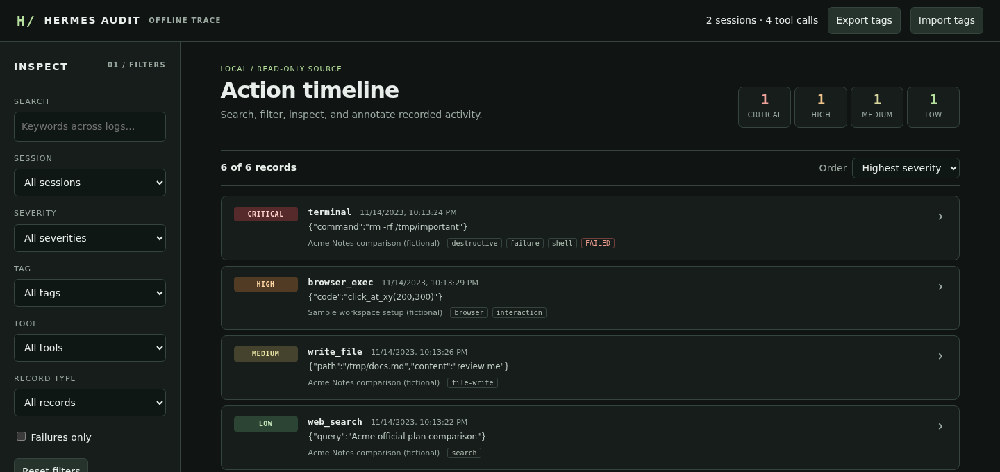
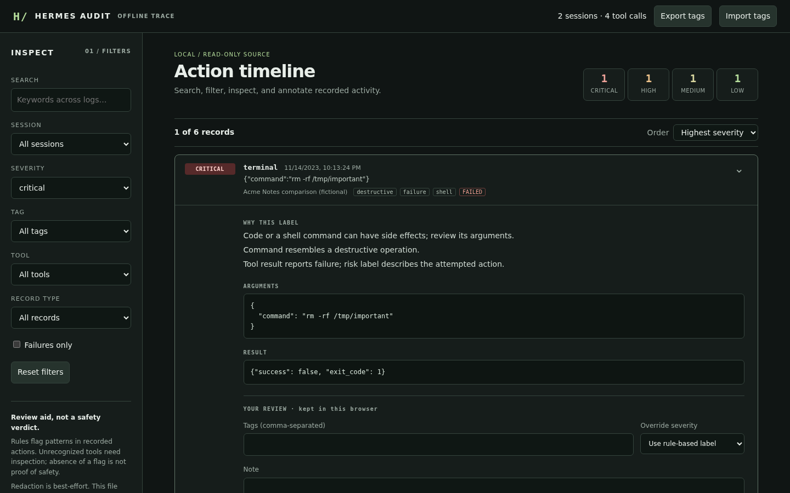
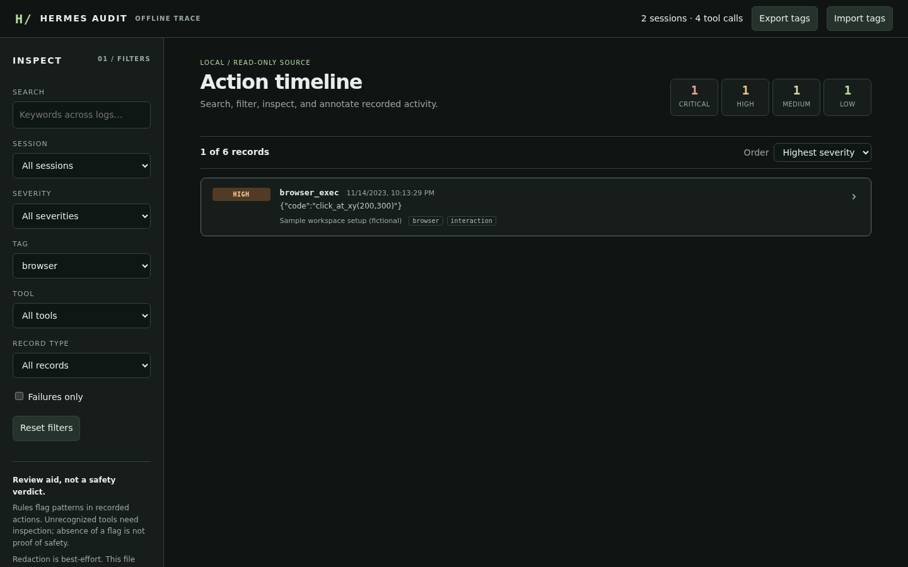

# Hermes Audit

A **local, read-only audit viewer** for [Hermes Agent](https://github.com/NousResearch/hermes-agent) session history. Turn `state.db` into one searchable HTML file you can open offline—no server, account, CDN, or Python runtime needed to *view* the report.

Filter recorded messages and tool calls by **severity, tag, tool, session, keyword, type, and failure**. Expand a record to inspect its arguments, result, and the rule that assigned its label. Add your own tags, notes, or severity overrides in your browser.

> [!IMPORTANT]
> Audit labels are review prompts, **not** proof that an action was dangerous or safe. Generated reports can contain private conversations despite best-effort redaction. Keep them local and inspect them before sharing.

## Screenshots — fictional data only

These screenshots come from the repository's **synthetic test fixture**. They contain no actual Hermes sessions or user credentials.

**All sessions and severities, ordered by highest severity**



**Critical action, with the recorded result and classification explained**



**Browser tag filter**



## Get started

**Requirements:** Python 3.10+ to generate a report, and a Hermes profile containing `state.db`. The exporter uses only Python's standard library. Modern browsers can open the resulting file offline.

### Install directly from GitHub

```bash
python -m pip install git+https://github.com/rezzaghi/hermes-audit.git
hermes-audit --out audit-report.html
```

Open `audit-report.html` locally. By default, the tool reads `$HERMES_HOME/state.db` when `HERMES_HOME` is set, or `~/.hermes/state.db` otherwise. The database is opened **read-only**. An existing HTML report is replaced by a fresh snapshot when you run the command again; it does not live-refresh.

### Or run from a clone without installing

```bash
git clone https://github.com/rezzaghi/hermes-audit.git
cd hermes-audit
python -m hermes_audit --out audit-report.html
```

On a machine where the Hermes database is elsewhere, provide its path:

```bash
python -m hermes_audit --db /path/to/state.db --out audit-report.html
```

### Try it without using your own logs

From the cloned repository, generate a deliberately fictional database and report:

```bash
python tests/fixture.py demo.db
python -m hermes_audit --db demo.db --out demo.html
```

Both generated files are ignored by Git. You can safely explore the severity and tag filters without opening a personal session.

## Useful commands

```bash
# All sessions in the selected database, all severities (default):
hermes-audit --out audit-report.html

# One session and its child/delegated/compression sessions:
hermes-audit --session SESSION_ID --lineage --out investigation.html

# Export only high and critical tool actions (no chat messages):
hermes-audit --min-severity high --out high-risk.html

# Explicit database path (for another profile or copied database):
hermes-audit --db /path/to/state.db --out profile-report.html

hermes-audit --help
```

Inside the report, filters combine: you can select a session and tag, then search within those results. The report loads matching cards in batches, but the count reflects every match. **Export tags** saves annotations as JSON; **Import tags** restores them on another browser. Annotations live in browser storage, not in Hermes's database.

## How to read a label

- `critical`: rules for destructive shell attempts or access to sensitive credential paths.
- `high`: external writes/sends or an interaction that warrants closer review.
- `medium`: local writes, opaque code execution, or actions needing contextual review.
- `low`: straightforward reads and searches.
- `info`: conversation messages included for context.

Each record lists the specific reason and tags behind its label. Failures remain visible and are labeled by the **attempted** action. A result without a matching call is shown as an orphan rather than discarded. These are retrospective heuristics, not execution-time protections.

## Privacy and limitations

- **Never publish a real report or database.** Real messages, local paths, and tool output may remain in the HTML even after redaction. Generated `*.html`, `*.db`, SQLite files, and annotation exports are ignored by Git; still inspect `git status` before committing.
- Reports are written with owner-only permissions (`0600`) on POSIX systems. Redaction recognizes common key fields, authorization headers, and JSON-encoded tool results, but **cannot guarantee removal of every secret or personal detail**.
- Report data and UI code are embedded in the HTML. Transcript text is escaped and rendered as text; the report has a restrictive Content Security Policy and makes no network requests. System prompts and provider reasoning are not exported.
- Tool wrappers may perform multiple internal steps. This report shows the **recorded** call and result, not every browser network request. `--lineage` includes descendants of the selected session, not ancestors.
- If browser storage is unavailable for local `file://` pages, export annotations before closing the report.

## Development

Node and Playwright are **test-only** dependencies; normal report generation needs neither.

```bash
npm ci
npx playwright install chromium
npm test
```

The suite covers SQLite ingestion and result pairing, risk rules, redaction, HTML/script safety, filtering, annotations, and offline Chromium rendering. All committed fixture data and screenshots are synthetic.

## License

MIT.
